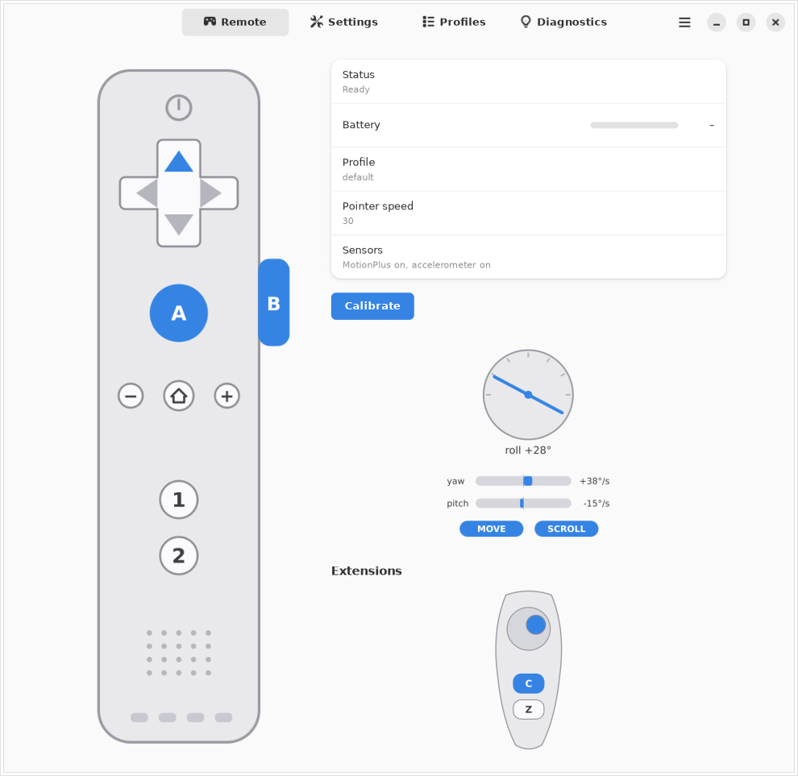

# Wii MotionPlus Mouse

[](https://github.com/Hakanbaban53/wiimote-mouse/actions/workflows/ci.yml)
[](LICENSE)
[](#install)

Use a Wii Remote with MotionPlus as a gyro mouse on Linux (X11 and Wayland). It runs as a systemd
user service without root, recovers by itself when the remote sleeps and wakes, and can be controlled
from a terminal (`wiimotectl`) or a GTK 4 / libadwaita window (`wiimote-mouse-ui`) while it runs.

```
 Wii Remote ──(hid-wiimote)──▶  wiimote-mouse daemon  ──▶ virtual mouse / keyboard (uinput)
                                       │
                       local control socket (JSON lines)
                          ▲                      ▲
                     wiimotectl            wiimote-mouse-ui (GTK 4 + libadwaita)
```

The daemon does all the work and runs fine headless. `wiimotectl` and the UI are thin clients of its
control socket, so everything you can click can also be scripted.

## Install

```bash
git clone https://github.com/Hakanbaban53/wiimote-mouse.git
cd wiimote-mouse
./install.sh                  # user files, udev rule, service (sudo only for the system files)
wiimote-mouse --doctor        # checks every dependency and tells you what to fix
```

Or download a release archive from the [Releases page](https://github.com/Hakanbaban53/wiimote-mouse/releases),
unpack it and run `./install.sh` inside. Updating is the same: pull or download the new version and run
`./install.sh` again (your settings are kept).

Requires `python-evdev` (Arch/CachyOS: `sudo pacman -S python-evdev`), Python 3.9+ (3.11+ to read
`config.toml`) and optionally `libnotify` for desktop notifications. The UI additionally needs GTK 4,
libadwaita, PyGObject and librsvg (Arch/CachyOS: `sudo pacman -S python-gobject gtk4 libadwaita librsvg`). Pair and trust the remote with
`bluetoothctl` first. The installer creates a `wiimote` group and adds you to it; **log out and back in
once** so the LED feedback can work (sysfs LED files do not support ACLs). Everything else works without it.

## Using the remote

| Button | Default profile |
|---|---|
| B (held) | move the cursor (the gyro clutch) |
| 1 / 2 | left / right click |
| D-pad | scroll, repeating while held |
| A (held) + tilt | smooth vertical scrolling |
| + / − | pointer speed (remembered) |
| HOME | recalibrate (hold the remote still) |

**LEDs:** one LED = connected or asleep, the middle two = calibrating (hold still), a bar of 1-4 LEDs =
ready, where the bar length is the sensitivity level.
**Rumble:** 1 buzz = ready, 2 = calibration is stuck, 3-4 = battery low.

After `power.idle_sleep_seconds` (default 5 min) without button activity the MotionPlus is closed so the
remote stops streaming; any button wakes it. After waking, hold the remote still for a moment while it
recalibrates.

## Profiles

A profile maps buttons to actions; it only lists what differs from `default`. Built in: `default`,
`presentation` (D-pad and A change slides, 2 is Escape), `media` (play/pause, volume, tracks).

```bash
wiimotectl profile list
wiimotectl profile set presentation
wiimotectl profile bind ptt two key:KEY_F13        # new profile: button 2 is F13 (push-to-talk)
wiimotectl profile bind ptt home none              # switch a button off
```

Actions: `pointer.hold`, `scroll.hold`, `mouse.left/right/middle`, `scroll.up/down/left/right`,
`sensitivity.up/down`, `calibrate`, `profile.next/previous`, `profile:<name>`, `key:KEY_A+KEY_B` (a chord,
held while the button is held) and `exec:command args` (runs when pressed, no shell). A button can also be
a table with one-shot `press` / `release` actions, for example to unmute a microphone only while it is held:

```toml
[profiles.mic.buttons]
two = { press = "exec:wpctl set-mute @DEFAULT_AUDIO_SOURCE@ 0", release = "exec:wpctl set-mute @DEFAULT_AUDIO_SOURCE@ 1" }
```

Held keys, clicks and commands' release actions always fire when the remote disconnects, so nothing stays
stuck. The Wii Remote has no microphone, so "push-to-talk" means a button that controls your PC's mic.

## The UI

Open it with `wiimote-mouse-ui`, from the app menu ("Wii Remote Mouse"), or with `wiimotectl ui`. It talks
to the running daemon, so closing it changes nothing about how the remote behaves, and while it is closed it
costs the daemon nothing. If the daemon is not running it says so and offers to start the service.



- **Remote:** a live drawing of the remote (pressed buttons light up, the player LEDs show their real state),
  battery, mode, profile, pointer speed, a tilt gauge with yaw/pitch rates and the move/scroll state, and a
  panel for a plugged-in Nunchuk (stick and C/Z) or a generic readout for other extensions. The motion and
  extension streams are requested only while this page is visible, and the accelerometer is only switched on
  for that time too, so the UI does not drain the remote when you are on another page.
- **Settings:** one row per setting, generated from what the daemon reports, with a reset button when you
  changed one and a note when a change needs a restart. Changes apply immediately.
- **Profiles:** pick the active profile and edit what each button does; a field turns red if an action is
  rejected and keeps your text so you can fix it. Actions are the same text used in `config.toml` and wiimotectl.
- **Diagnostics:** the checks of `wiimote-mouse --doctor`.

It follows the system light/dark preference. See also `docs/screenshots/` for the other pages.

## wiimotectl

```bash
wiimotectl status                        # daemon, remote, battery, extensions, profile
wiimotectl watch                         # live events (buttons, motion, extensions); --json for scripts
wiimotectl sensitivity 40                # or: up / down
wiimotectl config list                   # every setting, its value and where it comes from
wiimotectl config set tilt.roll_compensation true
wiimotectl config reload                 # re-read config.toml without restarting
wiimotectl calibrate | rumble 2 | led 5 | sensors sleep
wiimotectl --help
```

Exit codes: 0 success, 1 the daemon rejected the command, 2 usage error, 3 the daemon is not reachable.

## Configuration

`~/.config/wiimote-mouse/config.toml` (see `config.example.toml`), checked with
`wiimote-mouse --check-config`. Layers, lowest to highest priority: built-in defaults, `config.toml`, and
`overrides.json` (written by `wiimotectl`, the UI and the + / − buttons). If you edit a value in
`config.toml`, your edit wins again over an older saved override. A bad value only produces a warning and
keeps the default; a file that is not valid TOML stops the service with exit code 2.

## Control protocol

Newline-delimited JSON over `$XDG_RUNTIME_DIR/wiimote-mouse/control.sock` (mode 0600, directory 0700):

```
→ {"id": 1, "cmd": "status"}
← {"id": 1, "ok": true, "result": {...}}
→ {"id": 2, "cmd": "subscribe", "topics": ["state", "buttons", "motion", "ext"]}
← {"event": "buttons", "data": {"button": "a", "pressed": true}}
```

Commands: `hello status calibrate config.get config.set config.reset config.reload profile.list profile.get
profile.set profile.cycle profile.save profile.delete rumble led sensors devices subscribe unsubscribe`.
Expensive streams (accelerometer, extension input) are only opened while a client subscribes to them, because
every open device makes the remote stream and drains its battery.

## Troubleshooting

```bash
wiimote-mouse --doctor
journalctl --user -u wiimote-mouse -f
```

| Symptom | Likely cause |
|---|---|
| Service stops right away, exit status 2 | `/dev/uinput` access or an invalid config: `--doctor` |
| "Waiting for a Wii Remote" | not connected: press a button on it; check pairing and trust |
| The cursor never moves, no LED bar | calibration is not finishing: put the remote down |
| LEDs never change | log out and back in after the installer added you to `wiimote` |
| `wiimotectl` says the daemon is not running | `systemctl --user start wiimote-mouse.service` |

## Development

```bash
python3 -m unittest discover -s tests -t .                          # 263 tests, about 15 s, no hardware needed
xvfb-run -a python3 -m unittest discover -s tests -t .              # all 283, including the 20 UI tests that need a display
xvfb-run -a python3 tools/ui_screenshots.py /tmp/shots [dark]      # regenerate the screenshots
```

The package is in `wiimote_mouse/`: `settings` (layered settings), `dsp` (gyro to pointer maths), `devices`
(finding and reading the remote), `profiles` (button mappings), `control` (the socket server), `daemon`
(the event loop), `feedback` (LEDs, rumble, battery), `ctl` and `client` (wiimotectl and its library), and
`ui/` (the GTK front end: `model` and `remote_svg` are plain Python, `link` is the non-blocking daemon
connection, `app` the windows).

## Uninstall

```bash
wiimote-mouse-uninstall            # installed by install.sh; asks first, keeps your settings
wiimote-mouse-uninstall --purge    # also deletes your settings, saved profiles and state
```

`./uninstall.sh` in the source tree does the same. Options: `--yes` (do not ask), `--user-only` (leave
the udev rule and the uinput autoload file, no sudo), `--remove-group` (also delete the `wiimote` group),
`--dry-run` (show what would be done). The `wiimote` group and the `uinput` module are left in place by
default because other software may use them.

## Contributing and reports

Bug reports and hardware test reports are very welcome: use the
[issue templates](https://github.com/Hakanbaban53/wiimote-mouse/issues/new/choose) and include the output of
`wiimote-mouse --doctor`. See [CONTRIBUTING.md](CONTRIBUTING.md) for how to run the tests (no Wii Remote
needed) and [CHANGELOG.md](CHANGELOG.md) for what changed.

## License and disclaimer

[MIT](LICENSE). This is an independent project. It is not affiliated with or endorsed by Nintendo; "Wii" and
"Wii Remote" are trademarks of Nintendo. The Wii Remote is driven by the Linux kernel's `hid-wiimote` driver.

## Verified, and not yet verified on real hardware

The logic is covered by automated tests with fake devices and checked against the Linux `hid-wiimote`
driver source. These need a real remote:

- **Roll compensation** (`tilt.roll_compensation`, off by default): the correction direction depends on the
  physical accelerometer axes. If sweeps get more diagonal, set `roll_invert = true`.
- **Battery percentage:** the kernel reports `capacity` out of 255 but a fresh battery sends about 200, so it
  reads about 78; this is normalized to 100%. Compare with `cat /sys/class/power_supply/wiimote_battery_*/capacity`.
- **Sleep/wake delay** of the MotionPlus differs between remotes.
- **LED permissions** (the `wiimote` group) can behave differently per distribution.
- **Extensions** (Nunchuk, Classic Controller, ...) are streamed from the kernel's documented axes and were
  only tested with fake devices.
- **The UI** was run and inspected on a virtual display with GTK 4.14 and libadwaita 1.5, not on a real
  desktop. Newer libadwaita should behave the same; layout details may differ slightly.
